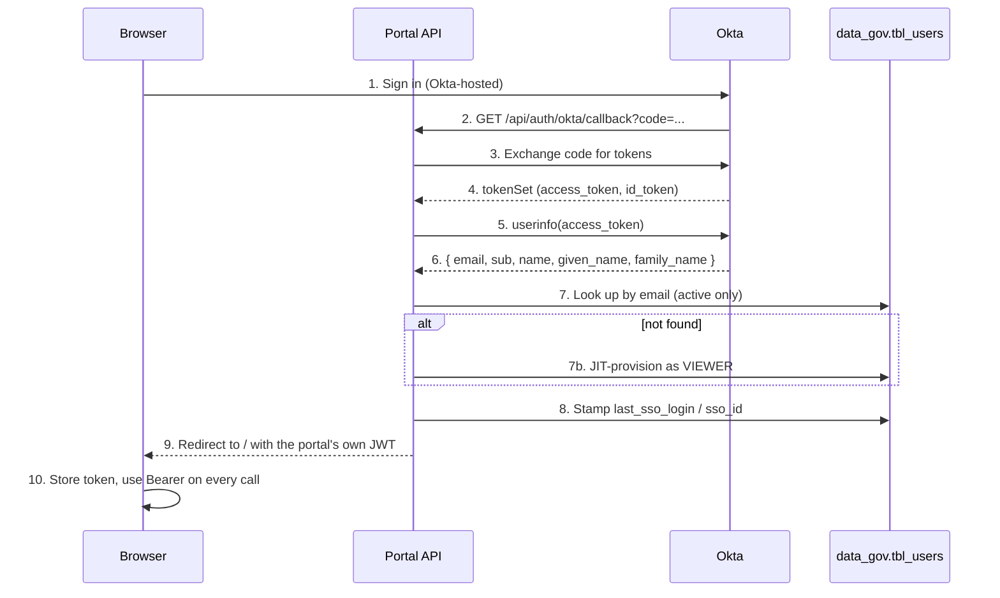

# Okta integration — Data Hub portal

How the portal authenticates people through Okta. Scope is the integration only:
the OIDC flow, the code that implements it, the configuration it needs, and how a
session is carried afterwards.

Everything below is drawn from the code as it stands on the `prod` branch. File
references are live links, so they can be checked rather than trusted.

---

## 1. In one paragraph

Okta is the **identity** provider and nothing more. It answers one question —
*is this person who they say they are* — and the portal takes it from there.
Authorisation is entirely local: the role and the persona that decide what a user
can see come from the portal's own database, never from an Okta claim or group.
After a successful Okta login the portal mints **its own JWT** and uses that for
every subsequent request; Okta is not consulted again until the next sign-in.

---

## 2. The flow



**Authorization Code flow**, server-side. The client secret never reaches the
browser, and the code exchange happens in the API.

---

## 3. The code

All of it lives in one module: **[server/src/features/data-governance/routes/auth.js](../server/src/features/data-governance/routes/auth.js)**,
mounted under `/api/auth`. It uses the **`openid-client`** library.

### Client bootstrap

Discovery first, with a hand-built fallback so a discovery outage does not take
sign-in down with it:

```js
try {
  issuer = await Issuer.discover(issuerUrl);
} catch (discoverError) {
  issuer = new Issuer({
    issuer: issuerUrl,
    authorization_endpoint: `${endpointBase}/v1/authorize`,
    token_endpoint:         `${endpointBase}/v1/token`,
    userinfo_endpoint:      `${endpointBase}/v1/userinfo`,
    jwks_uri:               `${endpointBase}/v1/keys`,
    revocation_endpoint:    `${endpointBase}/v1/revoke`,
    end_session_endpoint:   `${endpointBase}/v1/logout`,
  });
}

oktaClient = new issuer.Client({
  client_id:     process.env.OKTA_CLIENT_ID,
  client_secret: process.env.OKTA_CLIENT_SECRET,
  redirect_uris: [redirectUri],
  response_types: ['code'],
});
```

The client is initialised **once, on module load**, and only when `DISABLE_OKTA`
is not `'true'` and both credentials are present. Missing credentials with Okta
enabled logs a warning at boot rather than failing at the first login.

### Endpoints

| Route | Purpose |
|---|---|
| `GET /api/auth/okta/config` | Frontend asks how to sign in. Returns `{ disabled: true, useLocalAuth: true }` when `DISABLE_OKTA=true`, otherwise client id, domain, issuer and redirect URI. |
| `GET /api/auth/okta/callback` | Where Okta sends the user back. Exchanges the code, reads userinfo, resolves the user, issues the portal JWT. |
| `GET /api/auth/me` | Decodes the portal JWT and returns the caller. |
| `POST /api/auth/refresh-token` | Re-reads `tbl_users` and reissues the JWT, so a role change takes effect without a new Okta login. |
| `POST /api/auth/local/login` | **Local development only.** Returns `403` unless `DISABLE_OKTA=true`. |

### IdP-initiated logins

If someone launches the app from their Okta dashboard, the callback is reached
with no `code`. Rather than error, it starts a proper SP-initiated flow:

```js
const authorizeUrl = `https://${domain}/oauth2/v1/authorize?client_id=${clientId}`
  + `&response_type=code&scope=openid%20profile%20email`
  + `&redirect_uri=${encodeURIComponent(redirectUri)}&state=idp_initiated`;
return res.redirect(authorizeUrl);
```

### JIT provisioning

A first-time user does not need a row created in advance. The callback inserts
one:

```js
let dbUser = await findActiveUser(userInfo.email);
if (!dbUser) {
  await db.query(
    `INSERT INTO tbl_users
       (email, first_name, last_name, display_name, role, is_active, sso_provider, sso_id, last_sso_login)
     VALUES ($1, $2, $3, $4, 'VIEWER', true, 'okta', $5, NOW())
     ON CONFLICT (email) DO UPDATE
       SET is_active = true, sso_provider = 'okta',
           sso_id = COALESCE(tbl_users.sso_id, EXCLUDED.sso_id),
           last_sso_login = NOW()`,
    [userInfo.email, firstName, lastName, displayName, userInfo.sub],
  );
  dbUser = await findActiveUser(userInfo.email);
}
```

Two consequences worth stating plainly:

- **Anyone Okta lets through gets an account**, as `VIEWER`. Who can sign in is
  controlled in Okta — by who is assigned the application — not in this code.
- Pre-creating a row is therefore optional. It is still useful when someone
  should arrive on a particular persona rather than the default.

Lookup is **`WHERE email ILIKE $1 AND is_active = true`**. Deactivating a user in
`tbl_users` blocks them even if Okta still authenticates them; they are not
re-provisioned, because the `ON CONFLICT` branch only runs for a user the lookup
missed — and a deactivated row would be reactivated by it, so deactivation alone
is not a durable block. Remove the Okta assignment as well.

---

## 4. The session after login

Okta's tokens are **not** used to authorise requests. The portal signs its own:

```js
jwt.sign(
  { username: email, name: fullName, role: dbUser.role || 'VIEWER', email, user_id },
  getJwtSecret(),
  { expiresIn: '7d' },
)
```

`role` comes from **`tbl_users.role`**, not from Okta.

The callback then does two things with it:

1. Sets an httpOnly cookie `datahub_token` — `secure` in production, `sameSite: 'lax'`, 24 hours. Used by auth-gated pages served directly by the API, such as the Copilot report.
2. Redirects to `/?token=…&id_token=…`, which the SPA picks up.

**On the browser side**, [src/App.tsx](../src/App.tsx) extracts those parameters,
validates each against a JWT shape regex before storing, and writes them to
`localStorage`. [src/lib/auth/token.ts](../src/lib/auth/token.ts) owns that storage and
notifies other tabs on sign-out. [src/lib/apiFetch.ts](../src/lib/apiFetch.ts) attaches
`Authorization: Bearer <token>` to every API call and, on a `401`, retries **once**
after calling `/api/auth/refresh-token`.

**On the server side**, every protected route goes through `requireAuth` in
[server/src/middleware/jwtAuth.js](../server/src/middleware/jwtAuth.js), which verifies the
signature and populates `req.user` with `{ user_id, email, name, role }`. That is
the only auth middleware the API has.

`refresh-token` verifies with `ignoreExpiration: true` — deliberately. An expired
token can still be exchanged, but the **signature is still checked**, so a forged
token cannot be used to impersonate anyone.

---

## 5. Configuration

There is **one Okta application per environment**, so the redirect URIs differ and
the credentials are not shared.

| Variable | Notes |
|---|---|
| `OKTA_DOMAIN` | e.g. `prosightspecialty.okta.com` |
| `OKTA_ISSUER` | Discovery base |
| `OKTA_CLIENT_ID` | Per environment |
| `OKTA_CLIENT_SECRET` | **Secret.** Per environment |
| `OKTA_AUDIENCE` | |
| `OKTA_REDIRECT_URI_PROD` | `https://data.coactionspecialty.com/api/auth/okta/callback` |
| `OKTA_REDIRECT_URI_DEV` | `http://localhost:5050/api/auth/okta/callback` |
| `DISABLE_OKTA` | `true` enables local login. **Development only.** |
| `JWT_SECRET` | **Secret.** Signs the portal's own token |

Which redirect URI is used is chosen by `NODE_ENV === 'production'`, not by the
branch or the host name.

**Deployment.** The runtime `.env` is generated by
[azure-pipelines.yml](../azure-pipelines.yml) from an explicit list, and all seven
`OKTA_*` variables appear in it for both environments. `OKTA_CLIENT_SECRET` is read
as `$Env:OKTA_CLIENT_SECRET` and therefore also needs an entry in the step's `env:`
block — a variable added to the ADO variable group but *not* enumerated in that
list never reaches the server.

---

## 6. Local development without Okta

Set `DISABLE_OKTA=true`. `GET /okta/config` then reports `useLocalAuth`, and
`POST /api/auth/local/login` accepts `{ email }` — but only for an email that
already exists and is active in the database the server is pointed at. It issues
the same JWT the Okta path does, so everything downstream behaves identically.

`POST /local/login` returns **403** whenever `DISABLE_OKTA` is not `'true'`, so it
cannot be reached in a deployed environment.

---

## 7. What this integration does not do

Stated because each of these is a reasonable thing to assume:

- **No Okta groups or claims are read.** Only `email`, `sub`, `name`,
  `given_name`, `family_name` from userinfo.
- **Roles do not come from Okta.** `tbl_users.role` is the source, managed in the
  portal's own admin screens.
- **Personas do not come from Okta.** They are assigned in `tbl_user_persona`.
- **No SCIM, no directory sync.** Users appear in the portal when they first sign
  in, or when someone adds them deliberately.
- **No group-to-role mapping.** A new user is always `VIEWER` until changed.
